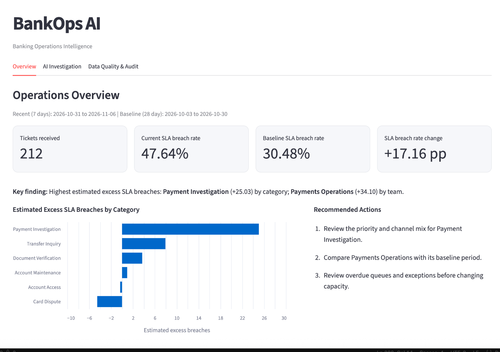
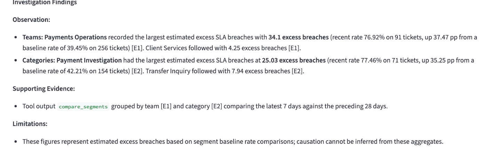
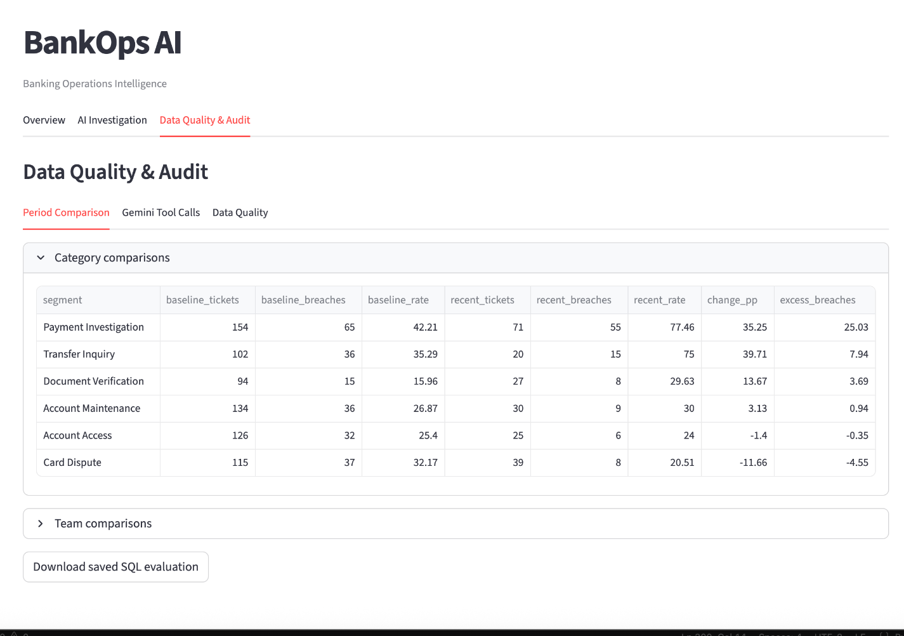
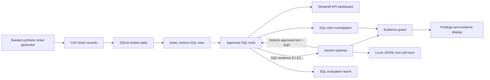

# BankOps AI

**Banking operations analytics with evidence-backed AI investigation**
Python · SQLite · SQL · Streamlit · pandas · Altair · Gemini tool calling

BankOps AI compares banking service-request performance with a historical baseline, pinpoints where breaches are concentrated, and lets an analyst investigate the evidence through approved SQL tools. The optional Gemini layer explains results; it cannot execute arbitrary model-written SQL.



## The business problem

A bank's operations manager opens a weekly performance report and sees that service-level agreement (SLA) breaches are rising. That single percentage is not enough to decide what to do next:

- Is the deterioration widespread or concentrated in a particular service category?
- Which operational teams warrant a closer review?
- Did a segment's breach **rate** rise, or did it produce more breaches than its own historical rate would predict?
- Can an analyst explain the finding with traceable numbers rather than an unsupported AI narrative?

**BankOps AI models the analyst's workflow: detect → investigate → communicate → audit.** It is a demonstration built on reproducible **synthetic banking service tickets**, not bank customer records or a deployed banking product.

### Primary user story

> As a **banking operations analyst**, I want to **compare recent SLA performance with a historical baseline and identify where the deterioration is concentrated**, so that I can **prioritize targeted operational reviews and share defensible findings with stakeholders**.

### Supporting user stories

| User | Need | What BankOps AI provides |
| --- | --- | --- |
| Operations manager | Understand changes quickly | KPI snapshot, category chart, recommended follow-up checks |
| Operations analyst | Identify the highest-priority segments | 7-day vs 28-day comparisons, rates, excess-breach estimates, supporting tables |
| Analyst using AI | Ask an operational question without relying on invented figures | Gemini with an allowlist of predefined read-only SQL tools and cited evidence |
| Data quality reviewer | Inspect how an answer was produced | SQL result tables, tool-call traces, and selected data-quality checks |

See the full [business case and acceptance criteria](docs/BUSINESS_CASE.md).

## Example findings from the reproducible demo

The deterministic demo contains **2,600 synthetic service requests**. In its latest ticket-created cohort, the application reports:

| Metric | Result |
| --- | ---: |
| Recent cohort | 212 tickets (Oct 31–Nov 6, 2026) |
| Baseline cohort | 725 tickets (Oct 3–Oct 30, 2026) |
| Recent SLA breach rate | **47.64%** |
| Baseline breach rate | **30.48%** |
| Change | **+17.16 percentage points** |
| Highest category-level estimated excess | **Payment Investigation: +25.03** |
| Highest team-level estimated excess | **Payments Operations: +34.10** |

**How to interpret this:** Payment Investigation and Payments Operations are two *overlapping ways of grouping the same service requests*. Their estimated excess breaches must not be added together. These comparisons indicate **where to investigate**, not why the deterioration occurred. The sample deliberately includes simulated changes; it is not evidence about a real bank.

### 1. Detect: Operations Overview

The dashboard compares a **recent seven-calendar-day ticket-created cohort** to the **preceding 28 days**, anchored to the maximum `created_at` date in SQLite rather than today's date. It shows tickets received, breach rates, percentage-point change, estimated excess breaches by category, and recommended next checks.

### 2. Investigate: SQL-only or AI-assisted

The default investigation uses deterministic SQL-backed findings and **does not require an API key**. Enabling AI allows Gemini to select from approved read-only tools. Evidence results are assigned citations (`[E1]`, `[E2]`, etc.) that the reviewer can open in the UI.



Gemini can help write an explanation, but the application checks evidence references and numeric support. If the response fails these checks or an API call is interrupted, the app returns a **SQL-generated fallback** where possible. This is a conservative *consistency check*, **not** proof that a narrative or causal claim is correct.

### 3. Audit: Inspect the result

The Data Quality & Audit page exposes category/team comparisons, selected data-quality checks, and logged Gemini tool events.



## Architecture



This is a **local analytics prototype**, not an enterprise banking system. See [architecture and controls](docs/ARCHITECTURE.md) for precise module responsibilities and the distinction between read-only SQL tools and model output.

## Run locally

**Prerequisites:** Python **3.9+** (Python 3.11 is used by the CI workflow), `pip`, and Git. Commands below assume a shell opened **at the repository root**.

```bash
# 1. Clone the repository (replace with your actual GitHub URL)
git clone https://github.com/YOUR-USERNAME/bankops-ai.git
cd bankops-ai

# 2. Create an isolated Python environment
python3 -m venv .venv
source .venv/bin/activate             # macOS / Linux
# Windows PowerShell: .venv\Scripts\Activate.ps1

# 3. Install dependencies
python -m pip install --upgrade pip
python -m pip install -r requirements.txt

# 4. Generate the reproducible CSV, SQLite DB, and evaluation report
python -m scripts.setup_demo

# 5. Start the application
python -m streamlit run app.py
```

Open the localhost address printed by Streamlit, normally `http://localhost:8501`.

**No Gemini key is necessary** to explore the dashboard, comparisons, data-quality checks, or SQL-only investigation.

### Optional: Enable Gemini

```bash
cp .env.example .env
```

Edit `.env` locally and add your own `GEMINI_API_KEY`. Set `GEMINI_MODEL` to a model available to your account if the default is unavailable. The application loads `.env` locally via `python-dotenv`; **never commit it**. Alternatively, enter the API key in the Streamlit password field. Live calls require a reachable Gemini API and account access.

### Validate before your first demo

```bash
python -m unittest discover -s tests -v
python -m scripts.smoke_check
python -m py_compile app.py
python -m scripts.evaluate_segments
```

Automated tests use generated synthetic data and mocks. They do **not** prove that a live Gemini model will always produce an acceptable response. See [testing and validation](docs/TESTING.md).

## Repository structure

```text
bankops-ai/
├── app.py                         Streamlit: Overview, AI Investigation, Audit
├── src/
│   ├── __init__.py
│   ├── generate_data.py           Deterministic synthetic ticket generator
│   ├── database.py                CSV validation, SQLite load, ticket_metrics view
│   ├── analysis.py                Read-only query helper and summary utilities
│   ├── investigation.py           Allowlisted SQL analytical tools + segment metrics
│   ├── ai_assistant.py            Gemini function declarations / tool-call loop
│   ├── evidence_guard.py          Answer checks and question-aware SQL fallback
│   └── tool_trace.py              Local JSONL tool-call event logger
├── scripts/
│   ├── setup_demo.py              Regenerate demo data, DB and saved report
│   ├── evaluate_segments.py       Export baseline and segment SQL comparison
│   ├── smoke_check.py             Offline end-to-end analytics sanity check
│   └── diagnose_gemini.py         Optional live SDK/model connection diagnostic
├── tests/                         Unit/regression tests with synthetic fixtures
├── reports/
│   └── segment_evaluation.json    Example reproducible SQL evaluation snapshot
├── assets/
│   ├── overview.png               Dashboard screenshot
│   ├── ai-investigation.png       Evidence-backed AI answer screenshot
│   └── audit.png                  Audit interface screenshot
├── docs/                           Business, architecture, data, AI, testing, demo
├── data/                           Generated CSV/DB (ignored by Git)
├── logs/                           Generated local Gemini traces (ignored by Git)
├── .github/workflows/tests.yml     CI: generate data, run tests and smoke check
├── .env.example                    Safe configuration example
├── .gitignore                      Credentials, local data and backups excluded
└── requirements.txt                Runtime dependencies
```

The `.csv`, `.db`, `.env`, virtual environment, and local tool traces are **not included in the repository**. They are created locally when needed. The sample report and screenshots are derived from the synthetic dataset.

## Design and evaluation notes

- **Excess breaches** for segment \(s\) are computed as `recent_breaches - recent_tickets × (baseline_breaches / baseline_tickets)`. They are **estimated baseline-adjusted counts**, not directly observed causal contributions.
- **Rate change** is expressed in **percentage points**, not percent growth, and the 7-day and 28-day cohorts have different denominators.
- **SLA breaches** are derived from a ticket deadline and resolution timestamp, or for open tickets, a fixed synthetic reporting `as_of` timestamp (`2026-11-13T00:00:00`).
- **AI controls** restrict tool names, argument shapes, and dimensions. The model does not receive a free-form SQL execution tool.
- **Data checks** cover selected date/status inconsistencies, not comprehensive banking compliance or production observability.

See [data dictionary and metrics](docs/DATA_AND_METRICS.md) and [AI workflow and guardrails](docs/AI_INVESTIGATION.md).

## Limitations and intended use

This is a **portfolio demonstration**, not a deployed financial-services application. The data is synthetic; rates are not representative of a bank. The scenario includes deliberate simulated deterioration, so interpretation should remain descriptive. The current fallback handles common comparison questions but not every arbitrary natural-language query. Tool trace logging stores question text and result rows locally, so the implementation **must not be used with real customer records without additional privacy/security work**. There is no authentication, authorization, multi-user governance, production monitoring, or deployment hardening.

## Documentation

- [Business problem, user stories, and acceptance criteria](docs/BUSINESS_CASE.md)
- [Architecture, data flow, and component responsibilities](docs/ARCHITECTURE.md)
- [Data dictionary, SLA definition, and KPI calculations](docs/DATA_AND_METRICS.md)
- [Gemini tool calling, evidence checks, and limitations](docs/AI_INVESTIGATION.md)
- [Testing, reproducibility, and troubleshooting](docs/TESTING.md)
- [Demo script, release checklist, and GitHub publishing](docs/DEMO_AND_RELEASE.md)

**Project focus:** operational KPI design, SQL analysis, data validation, evidence traceability, and responsible use of AI for investigations.
