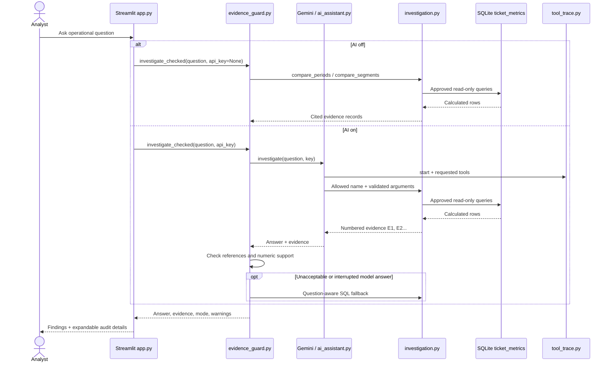

# Architecture and module guide

## System boundaries

BankOps AI runs as a local Streamlit application. A seeded Python generator produces CSV tickets, `src/database.py` imports them to SQLite, and SQL view `ticket_metrics` derives SLA outcomes. Predefined Python tool handlers execute read-only queries. The same tool layer serves the dashboard, deterministic fallback, and optional Gemini tool-calling workflow.

## Source files

| File | Responsibility | Main public functions |
| --- | --- | --- |
| `app.py` | UI, KPI cards, category chart, question control, evidence tables, audit subtabs | Streamlit entry point |
| `src/generate_data.py` | Deterministic synthetic tickets, including a simulated late-period payments pattern | `generate` |
| `src/database.py` | CSV validation, SQLite schema/indexes, fixed-as-of SLA view | `load` |
| `src/analysis.py` | Read-only SQL helper and basic aggregate functions | `query`, `summary`, `category_breakdown`, `weekly_trend` |
| `src/investigation.py` | Fixed read-only SQL analytics, validated tool dispatcher, segment comparison | `execute_tool`, `compare_segments`, `period_comparison`, `data_quality` |
| `src/ai_assistant.py` | Gemini tool declarations, controlled manual function-call loop, evidence IDs | `investigate` |
| `src/evidence_guard.py` | Reject unsupported numeric/citation claims and make question-aware SQL fallback | `verify_answer`, `investigate_checked` |
| `src/tool_trace.py` | Local JSONL logging of Gemini tool events/results | `write_trace` |
| `scripts/setup_demo.py` | One-command demo dataset/database/report setup | `main` |
| `scripts/evaluate_segments.py` | Saved SQL comparison output | `evaluate` |
| `scripts/smoke_check.py` | SQL-only data-to-finding acceptance test | `main` |
| `scripts/diagnose_gemini.py` | Optional live Gemini model connectivity diagnosis | Script entry point |

## Data flow

1. `generate_data.generate(..., seed=42)` writes approximately 2,600 synthetic service requests.
2. `database.load` validates IDs, statuses, chronology and due dates; constructs `tickets` and `ticket_metrics`.
3. `ticket_metrics` computes an SLA-breached indicator based on resolved timestamps and an explicit fixed synthetic observation date for open requests.
4. `investigation.execute_tool` accepts a **name from an allowlist** and validated arguments, not a free-form SQL query generated by Gemini.
5. `compare_periods` and `compare_segments` compute cohorts anchored to the latest ticket creation date.
6. The Streamlit Overview and Audit pages display those rows directly. The investigation page optionally asks Gemini to choose tools, then renders evidence and either a checked model response or a deterministic fallback.

## Model access constraints

Allowed tool names: `compare_periods`, `compare_segments`, `get_breakdown`, `get_weekly_trend`, `get_open_backlog`, `get_data_quality`.

Allowed dimensions: `category`, `team`, `priority`, `channel` where applicable. Category filters are bound SQL parameters. Unexpected tool names or arguments are rejected. This reduces risk relative to raw text-to-SQL; it does **not** constitute comprehensive sandboxing, authorization, or compliance controls.

**Important limitations:** The general developer `query` helper enforces a `SELECT` prefix but is not exposed to Gemini. The generator's `synthetic_slowdown_flag` is a synthetic scenario-design artifact; analytical tools should not use it to manufacture an explanation. `src/analysis.py` also contains a historical `compare_periods` helper with older full-history semantics; the dashboard uses `src/investigation.py` comparisons instead. Do not substitute one for the other when reproducing screenshot KPIs.

## Secrets, trace logging, and privacy

`.env` is ignored; `.env.example` contains placeholders only. API keys may be entered locally through Streamlit's password input. The JSONL trace contains user question text, tool inputs, and some output rows, and is **not appropriate for real personal or financial data without privacy controls**. The repository intentionally excludes local logs, CSV exports, and databases. No user authentication or production isolation is implemented.
